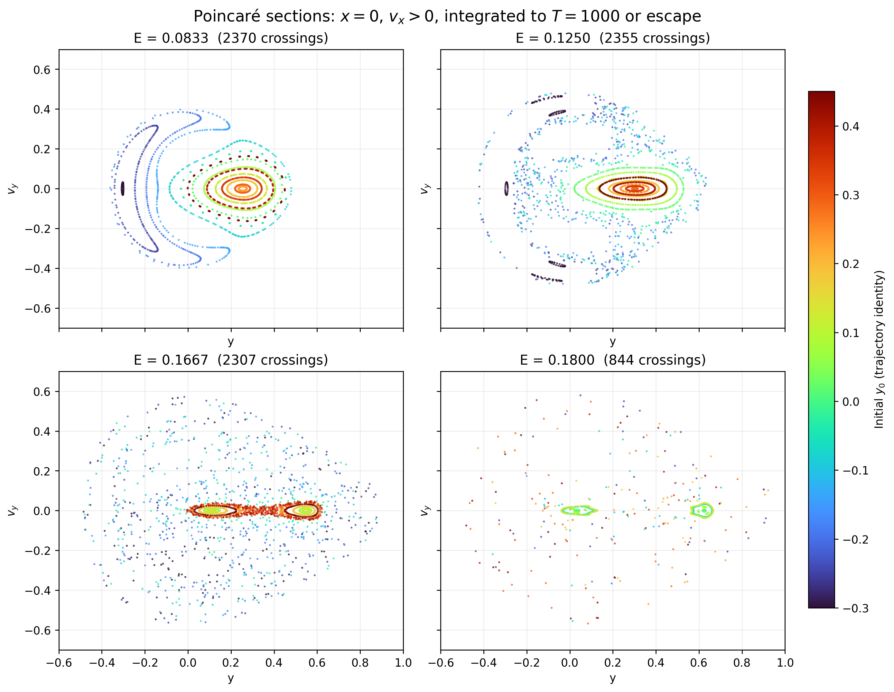
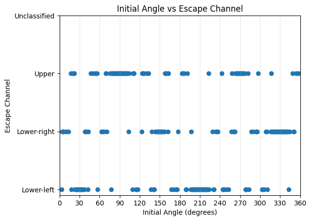
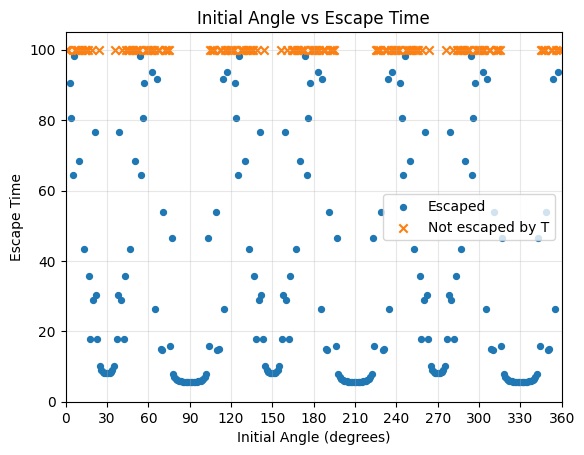
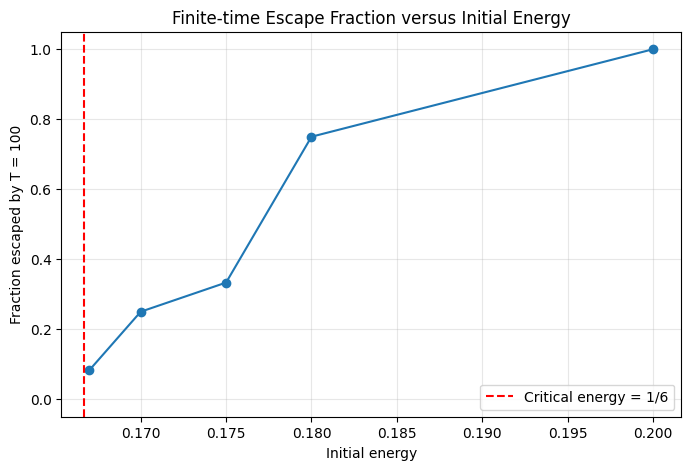

# Escape Dynamics in the Hénon–Heiles System

A computational physics project on how energy and initial launch direction affect particle trajectories, escape channels, and escape times in the two-dimensional Hénon–Heiles system.


## Project files

| File | Description |
|---|---|
| [`Henon_Heiles_Python_Implementation.ipynb`](Henon_Heiles_Python_Implementation.ipynb) | Main Jupyter notebook: implementation, experiments, plots, and saved outputs |
| [`Report/main.pdf`](Report/main.pdf) | Compiled project report |
| [`Report/main.tex`](Report/main.tex) | Editable LaTeX source for the report |
| [`Report/figures/`](Report/figures/) | Figures used in the report |
| [`images/`](images/) | Selected figures embedded in this README |
| [`Report/BUILDING.md`](Report/BUILDING.md) | Instructions for rebuilding the report |

**GitHub repository:** [Henon-Heiles-Problem-Implementation](https://github.com/mogit5756/Henon-Heiles-Problem-Implementation)

> **Repository layout:** Keep `README.md`, the notebook, and the `Report/` folder at the repository root. The embedded figures use paths relative to this README and point to files already used by the report.

## 1. Physical model

The Hénon–Heiles system is a two-degree-of-freedom Hamiltonian model originally introduced in the context of stellar dynamics. We use dimensionless coordinates and unit mass. The potential is

$$
V(x,y)=\frac{1}{2}(x^2+y^2)+x^2y-\frac{1}{3}y^3.
$$

The total mechanical energy is conserved by the exact equations of motion:

$$
E=\frac{1}{2}(v_x^2+v_y^2)+V(x,y).
$$

Using Newton's second law, $\ddot{\mathbf r}=-\nabla V$, gives

$$
\ddot{x}=-x-2xy,\qquad
\ddot{y}=-y-x^2+y^2.
$$

The three equivalent saddle points are $(0,1)$ and $(\pm\sqrt{3}/2,-1/2)$. Their potential energy is

$$
E_c=\frac{1}{6}\approx 0.1667.
$$

Below this energy, the central energetically allowed region is closed. Above it, three escape passages become accessible. Whether a particular particle escapes, which channel it uses, and how long it takes also depend on its initial condition.

## 2. Numerical method

### Main trajectory integrator: Velocity Verlet

The notebook implements the second-order Velocity Verlet method for the position-dependent acceleration $\mathbf a(\mathbf r)=-\nabla V$:

$$
\mathbf r_{n+1}=\mathbf r_n+\mathbf v_n\Delta t+\frac{1}{2}\mathbf a_n\Delta t^2,
$$

$$
\mathbf v_{n+1}=\mathbf v_n+\frac{1}{2}(\mathbf a_n+\mathbf a_{n+1})\Delta t.
$$

For the angular scans, every particle starts at the origin and has the same initial energy. The launch angle $\theta$ determines the initial velocity:

$$
x_0=y_0=0,\qquad
v_{x,0}=\sqrt{2E}\cos\theta,\qquad
v_{y,0}=\sqrt{2E}\sin\theta.
$$

The primary angular and energy scans use $T=100$, $N=20{,}000$ steps per trajectory, and therefore $\Delta t=0.005$.

### Independent solver: SciPy DOP853

SciPy's `solve_ivp` with DOP853 is used for two supporting tasks:

1. Generating the Poincaré sections.
2. Independently checking selected Velocity Verlet trajectories, including sensitive launch angles near an escape-basin boundary.

DOP853 is not used for the full angular or energy scans. The main scans use the notebook's own Velocity Verlet implementation.

## 3. Escape definition

The distance from the origin and its radial velocity are

$$
r=\sqrt{x^2+y^2},\qquad
v_r=\frac{xv_x+yv_y}{r}.
$$

A trajectory is recorded as escaped when a stored timestep satisfies both

$$
r>R,\qquad v_r>0,
$$

with the main escape radius set to $R=2.5$. The angle at the crossing is assigned to one of three approximate channel sectors:

| Channel | Angular sector |
|---|---:|
| Upper | $60^\circ$–$120^\circ$ |
| Lower-left | $180^\circ$–$240^\circ$ |
| Lower-right | $300^\circ$–$360^\circ$ |

These sectors are classification conventions for the three exits. The code also retains an `Unclassified` label for an outward crossing that falls outside the specified sectors. A trajectory that does not cross the escape radius before the simulation ends is labelled **not escaped by $T$**; this does not prove that it is permanently trapped.

## 4. What the notebook does

The notebook is organised into 20 numbered sections:

| Sections | Contents |
|---|---|
| 1–2 | Equations of motion, energy, escape geometry, and channel classification |
| 3–5 | Time grid, Velocity Verlet integration, initial conditions, simulation output, and plotting/error-analysis helpers |
| 6–7 | Confined-trajectory energy conservation and trajectories along the three symmetry directions |
| 8 | Poincaré sections at selected energies |
| 9–11 | Full angular escape sweep, channel and escape-time analysis, and transition counting |
| 12–14 | Threefold symmetry, independent DOP853 checks, DOP853 step-size stability, and Velocity Verlet timestep sensitivity |
| 15–17 | Coarse and refined energy-dependence scans |
| 18–20 | Fine angular basin scans, comparison across timestep resolutions, and uncertainty fractions |

## 5. Main numerical results

The values below are from the saved notebook outputs and the accompanying report. Escape fractions are always tied to the stated angular grid and finite observation time.

### 5.1 Energy conservation and symmetry checks

For a below-threshold trajectory with $E=0.08$, $T=100$, and $\theta=20^\circ$, the maximum absolute energy error is:

| Number of steps $N$ | Maximum $|E_n-E_0|$ |
|---:|---:|
| 5,000 | $9.19\times10^{-6}$ |
| 10,000 | $2.30\times10^{-6}$ |
| 20,000 | $5.74\times10^{-7}$ |

Doubling the number of steps reduces the error by approximately a factor of four, consistent with the second-order convergence of Velocity Verlet in this test. A similar reduction is observed for the escaping test at $E=0.18$ and $\theta=90^\circ$.

The potential has threefold rotational symmetry. Rotating the $90^\circ$ trajectory by $120^\circ$ and $240^\circ$ reproduces the trajectories launched at $210^\circ$ and $330^\circ$. The maximum coordinate differences are of order $10^{-14}$.

For the representative axial launch at $E=0.18$ and $\theta=90^\circ$, DOP853 gives an escape time of approximately $5.48554$, while Velocity Verlet reports $5.49$ at $N=20{,}000$. The small difference is expected because Velocity Verlet checks for escape at discrete timesteps rather than interpolating the exact crossing time.

### 5.2 Full angular sweep at $E=0.18$

The full sweep samples 360 launch angles from $0^\circ$ to $359^\circ$ at $1^\circ$ spacing, with $T=100$, $N=20{,}000$, and $R=2.5$:

- 228 of 360 trajectories escaped within $T=100$ (63.3%).
- 132 did not escape within the observation time.
- The 228 escapes were divided equally: 76 Upper, 76 Lower-left, and 76 Lower-right.
- The mean escape time among escaped trajectories was 29.86; the median was 14.9.
- The shortest and longest recorded escape times were 5.49 and 98.115.

The escape-channel and escape-time figures are in the report under the angular-sweep results.

### 5.3 Why the $E=0.18$ escape fractions differ between angular grids

The angular scans use deterministic, nested grids, and the outcome is not uniformly distributed with launch angle. The measured fraction therefore depends on the particular angles sampled:

| Angular spacing | Number of launches | Escaped | Finite-time fraction |
|---:|---:|---:|---:|
| $1^\circ$ | 360 | 228 | 63.3% |
| $5^\circ$ | 72 | 54 | 75.0% |
| $10^\circ$ | 36 | 30 | 83.3% |

The $5^\circ$ grid is a subset of the $1^\circ$ grid: its 72 angles are $0^\circ,5^\circ,\ldots,355^\circ$. Of these, 54 escape. The other 288 angles in the $1^\circ$ grid contain 174 escapes, or 60.4%. The $10^\circ$ grid is in turn a subset of the $5^\circ$ grid. Thus the coarser grids happen to sample a larger share of escaping directions. These are deterministic finite-grid fractions, not independent statistical estimates or exact escape probabilities.

### 5.4 Energy-dependence study

Both energy scans use $T=100$, $N=20{,}000$, and $R=2.5$. The coarse scan uses $10^\circ$ spacing (36 launches per energy); the refined scan uses $5^\circ$ spacing (72 launches per energy).

| Energy | Coarse scan ($10^\circ$) | Refined scan ($5^\circ$) |
|---:|---:|---:|
| 0.150 | 0/36 (0.0%) | — |
| 0.165 | 0/36 (0.0%) | — |
| 0.167 | — | 6/72 (8.3%) |
| 0.170 | 6/36 (16.7%) | 18/72 (25.0%) |
| 0.175 | — | 24/72 (33.3%) |
| 0.180 | 30/36 (83.3%) | 54/72 (75.0%) |
| 0.200 | 36/36 (100%) | 72/72 (100%) |

The overall trend is that a larger share of the sampled launch directions escapes within $T=100$ at higher energies. The exact measured fraction also depends on angular resolution, as shown above.

### 5.5 Poincaré sections

The Poincaré section records crossings of $x=0$ with $v_x>0$ and plots the crossing coordinates $(y,v_y)$. At each energy, 15 starting values of $y_0$ are sampled with $v_{y,0}=0$; the positive $v_{x,0}$ is obtained from the fixed-energy condition. The initial crossing at $t=0$ is excluded. Each orbit is integrated to $T=1000$ or stopped when it escapes.

| Energy | Saved crossings | Escaped trajectories |
|---:|---:|---:|
| $1/12$ | 2,370 | 0/15 |
| $1/8$ | 2,355 | 0/15 |
| $1/6$ | 2,307 | 0/15 |
| 0.18 | 844 | 11/15 |

At $E=1/12$, the sampled trajectories form organized curves. The $E=1/6$ panel contains a compact two-lobed island near the centre within a broader distribution. The $E=0.18$ panel is much sparser because 11 trajectories escape before $T=1000$ and therefore stop contributing crossings. The plots are qualitative diagnostics for this selected set of initial conditions, not a classification of the full phase space.



### 5.6 Sensitivity near an angular basin boundary

A local scan of 100 angles from $22^\circ$ to $23^\circ$ at $0.01^\circ$ spacing gives 37 adjacent outcome changes at $N=20{,}000$ and 50 at $N=40{,}000$. Comparing the labels point by point, 31 of the 100 outcomes (31%) change when the timestep is halved. The corresponding uncertainty-fraction curves also differ between the two resolutions. These results show that the local boundary classification is sensitive to numerical resolution; they are exploratory diagnostics and are not used to claim a fractal dimension.

Selected checks illustrate both agreement and disagreement between the methods:

| Launch angle | DOP853 result | Finest tested Velocity Verlet result |
|---:|---|---|
| $22.05^\circ$ | Upper, $t\approx93.145$ | Upper, $t\approx85.433$ at $N=640{,}000$ |
| $22.32^\circ$ | Lower-right, $t\approx63.136$ | Lower-right, $t\approx63.136$ at $N=640{,}000$ |
| $22.46^\circ$ | Upper, $t\approx97.2945$ | Not escaped by $T=100$ at $N=640{,}000$ |
| $22.89^\circ$ | Not escaped by $T=100$ | Not escaped by $T=100$ at $N=640{,}000$ |

DOP853 classifications for the tested $22.05^\circ$ and $22.46^\circ$ cases remain stable as its maximum step is reduced. This does not make DOP853 exact; near a complicated basin boundary, small trajectory differences can grow over time and alter a late escape classification.

## 6. Figures

Selected figures are included below. All report figures are stored in [`Report/figures/`](Report/figures/).

### Escape channel and escape time versus launch angle





These plots use $E=0.18$, $1^\circ$ angular spacing (360 launches), and observation time $T=100$. Crosses at the top of the escape-time plot mark trajectories that did not escape within this observation window.

### Escape fraction versus energy



This plot uses $5^\circ$ angular spacing (72 launches per energy), $N=20{,}000$, and $T=100$. The dashed vertical line marks $E_c=1/6$.

## 7. Limitations and interpretation

- **Finite observation time:** “Not escaped by $T$” does not mean permanently trapped. Escape fractions are conditional on the chosen observation time.
- **Escape definition:** The radius $R=2.5$ and the angular sectors are operational conventions. Velocity Verlet records the first stored timestep beyond the radius, so its escape time has timestep-level resolution.
- **Initial-condition coverage:** The angular and energy scans launch from the origin and vary only the velocity direction. The Poincaré sections use a separate, restricted family with $x_0=0$ and $v_{y,0}=0$. These samples do not cover the full energy surface.
- **Numerical sensitivity:** Some individual outcomes near the $22^\circ$–$23^\circ$ boundary change with timestep. The fixed-step Velocity Verlet method cannot automatically refine the timestep near sensitive trajectories.
- **Finite sampling:** The angular and energy grids contain a finite number of directions. Their escape fractions are grid-dependent finite-time measurements; no statistical error bars or universal probabilities are assigned.
- **Poincaré interpretation:** The sections use 15 initial conditions per energy and a finite integration time. They are qualitative phase-space diagnostics.
- **Basin geometry:** The uncertainty-fraction curves are exploratory. We have not calculated a fractal dimension or tested the Wada property.

## 8. Running the notebook

The notebook uses Python with NumPy, Matplotlib, and SciPy. From the project root, install the packages and start Jupyter:

```bash
python -m pip install numpy matplotlib scipy jupyter
jupyter lab
```

Open `Henon_Heiles_Python_Implementation.ipynb` and run the cells from top to bottom. The Poincaré calculation and fine-resolution boundary studies can take longer than the basic trajectory examples. The notebook includes saved outputs, so the results and plots can also be inspected without immediately rerunning every cell.

## 9. Rebuilding the report

A LaTeX distribution with `pdflatex` is required. From the `Report` directory, compile twice so cross-references are updated:

```bash
pdflatex main.tex
pdflatex main.tex
```

The report source is `Report/main.tex`, and its figures are in `Report/figures/`. More detailed build notes are in [`Report/BUILDING.md`](Report/BUILDING.md).

## 10. References

1. M. Hénon and C. Heiles, “The Applicability of the Third Integral of Motion: Some Numerical Experiments,” *The Astronomical Journal*, **69**, 73–79 (1964). [doi:10.1086/109234](https://doi.org/10.1086/109234).
2. J. Aguirre, J. C. Vallejo, and M. A. F. Sanjuán, “Wada basins and chaotic invariant sets in the Hénon–Heiles system,” *Physical Review E*, **64**, 066208 (2001). [doi:10.1103/PhysRevE.64.066208](https://doi.org/10.1103/PhysRevE.64.066208).
3. SciPy documentation, [`scipy.integrate.solve_ivp`](https://docs.scipy.org/doc/scipy/reference/generated/scipy.integrate.solve_ivp.html).

---

The notebook and report are intended to be read together: the notebook provides the implementation and numerical experiments, while the report gives the mathematical derivations, selected results, interpretation, and limitations.
